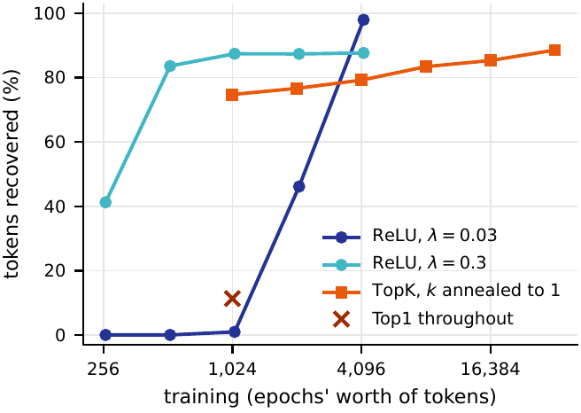
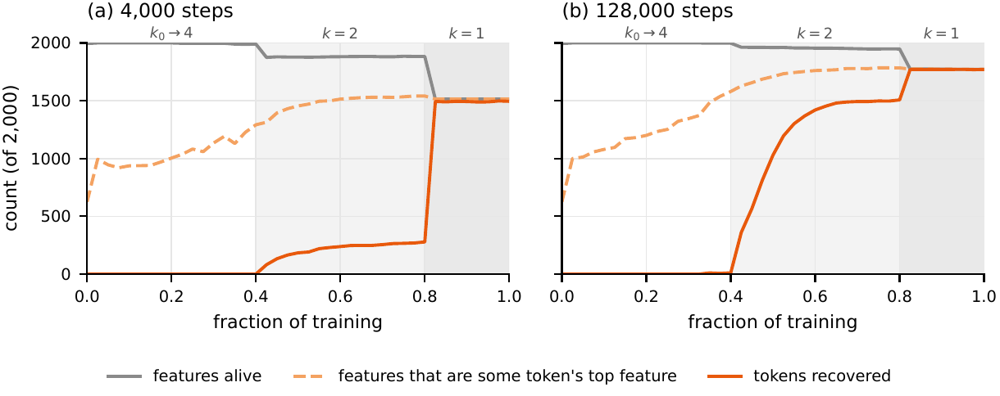
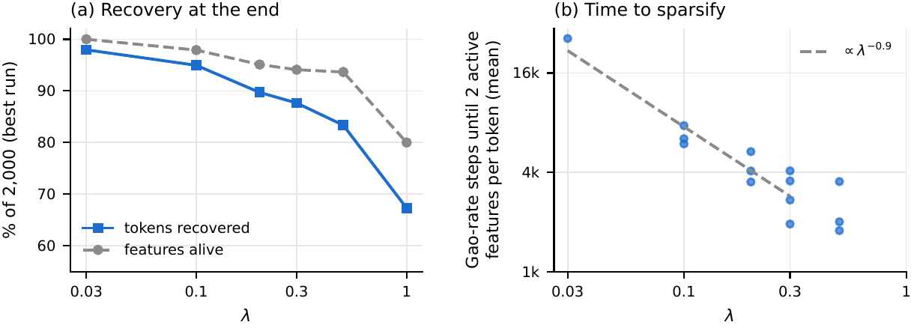
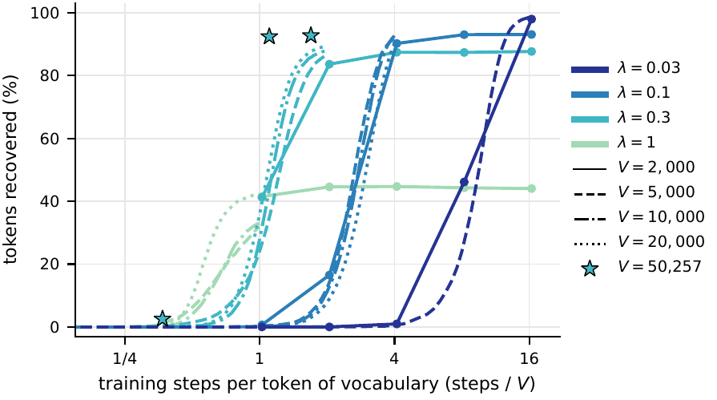

# Can a sparse autoencoder find the token embeddings?

### 📄 [Read the full write-up (PDF)](paper/main.pdf)

*A toy model of sparse autoencoder training with a known answer.*

---

Sparse autoencoders (SAEs) are a standard tool for finding interpretable features inside language models. But on real activations nobody knows what the true features are. So when an SAE gives a messy feature, it is hard to say why. Was the training at fault, was the dictionary too small, or is there no clean feature to find?

We built a setting where the answer is known. The data are the **raw token embeddings of GPT-2 Small**: 50,257 vectors in 768 dimensions, one per token. The SAE gets **exactly one feature per token**. With no bottleneck, the best dictionary is the embedding table itself: one feature pointing along each token.

So the question is simple: **does standard SAE training, from a random start, find it?** We count a token as *recovered* if some feature matches its embedding (cosine above 0.9).

## The short answer: yes, but the architecture decides how

<p align="center"></p>

Both common SAE architectures can find the embeddings. But they need very different regimes, at very different costs. On a 2,000-token vocabulary, a ReLU SAE with an L1 penalty recovers 98% of tokens. A TopK SAE needs eight times the training to reach 89%.

## TopK: features die every time $k$ drops

A TopK SAE with a fixed $k$ fails either way. Small $k$ leaves most features dead, and large $k$ smears every token over several features. What works is **annealing**: start with a large $k$ and lower it to 1.

<p align="center"></p>

Features die only at the drops in $k$, and the final drop to $k = 1$ is a **competition for slots**: a feature survives only if it is the top feature for some token. The survivors are almost all correct, so recovery is just the number of survivors. More training lets more features win a token before the drop. An auxiliary loss designed to revive dead features doesn't help here, because the problem is competition, not missing gradient.

## ReLU: the penalty must be weak, but not zero

<p align="center"></p>

For any positive penalty $\lambda$, the embeddings minimise the loss, and every GPT-2 embedding can in principle be coded by a single feature. A **smaller penalty kills fewer features and recovers more**, but it takes longer to make codes sparse. **With no penalty at all, nothing is recovered**: every exact reconstruction is equally good, and training settles on a dense one. So the best $\lambda$ is set by the training budget.

## Scaling: recovery doesn't depend on the vocabulary size

<p align="center"></p>

Give each vocabulary the same training per token, and recovery is the same at 2,000, 5,000, 10,000 and 20,000 tokens, for both architectures. The full 50,257-token table fits the same picture. **Small, cheap experiments predict the full-scale behaviour.** For TopK, the starting $k$ has to grow with the vocabulary, following a simple power law.

## In this repository

- [`paper/`](paper/): the write-up, with the script that draws every figure from the logged results.
- [`experiments/`](experiments/): ten experiments, each run by a single script.
- [`runs/`](runs/): the results of every run, as CSV and JSON tables.
- [`docs/reproducing.md`](docs/reproducing.md): **how to reproduce every result**, and a guide to the code.
- [`docs/README.md`](docs/README.md): the working notes for each experiment.

Rebuild all the figures from the tracked results in two commands:

```
pip install -e ".[paper]"
python paper/make_figures.py
```

This project was developed with Claude (Anthropic). The full conversation is in [`prompt_history/`](prompt_history/), for transparency. Licence: MIT.
